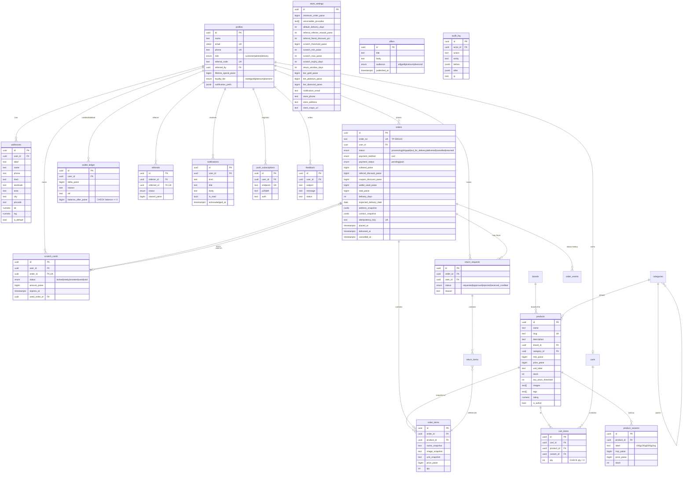

# Architecture

## Shape

```
Browser (360px Android, 4G)
   │  HTTPS, same origin
   ▼
Vercel / Netlify ── static PWA (React 18, Vite, Workbox)
   │  rewrite /api/* → backend origin
   ▼
FastAPI container (Render / Fly / Railway, always on)
   │  routers → services → repositories
   ├── Supabase Postgres (transaction pooler, asyncpg)
   ├── Supabase Auth (JWT verification via JWKS)
   ├── Supabase Storage (bucket `catalog`, public read / backend-only write)
   ├── (rate limits are rows in the same Postgres — no cache service)
   ├── Resend (transactional email)
   └── Web Push (VAPID)
```

The browser sees **one origin**: it calls `/api/v1/*`, the host rewrites to the
backend, so no CORS is needed in production and cookies/credentials stay simple.
CORS exists only for local development and previews, as an explicit allowlist.

## Layers (backend)

| Layer | Responsibility | Rule |
|---|---|---|
| `app/api/v1/endpoints/*` | HTTP parsing, auth dependencies, status codes | no business rules |
| `app/services/*` | **All** business rules (pricing, gates, wallet, referrals, stock, returns) | unit-tested, transaction-aware |
| `app/repositories/*` | SQLAlchemy queries | parameterised only; ownership in the `WHERE` |
| `app/models/*` | ORM tables, constraints | DB constraints back up every rule |
| `app/core/*` | config, errors, logging, middleware, security | framework glue |
| `app/schemas/*` | Pydantic v2 request/response models | strict, bounded, `extra="forbid"` |

Business rules live **only** in services. Routers never compute a total; the
frontend never computes a total that is trusted.

## Request flow (protected write, e.g. place order)

```mermaid
sequenceDiagram
  participant U as Customer (PWA)
  participant V as Vercel (rewrite)
  participant A as FastAPI
  participant R as Redis
  participant D as Postgres

  U->>V: POST /api/v1/orders (Bearer JWT, Idempotency-Key)
  V->>A: POST /api/v1/orders
  A->>R: rate limit check (user id, else IP)
  A->>A: verify JWT (JWKS, iss, aud, exp)
  A->>D: load profile (role from profiles.role)
  A->>A: service: gate checks (phone, pincode, minimum)
  A->>D: BEGIN; SELECT … FOR UPDATE (product rows)
  A->>D: recompute totals from DB prices, debit wallet, allocate order_no
  A->>D: INSERT order, items, events, wallet ledger, notifications
  A->>D: COMMIT
  A-->>U: 201 + order (idempotency key replay returns the same order)
  A-)U: notification bell + optional push/email
```

## Data model

Money is integer paise (`BIGINT`). Timestamps are `timestamptz` (UTC). Primary
keys are UUIDs except human order numbers (`TP-000123` from a sequence). Every
table has `created_at` and `updated_at` (trigger-maintained).



## Frontend structure

```
apps/web/src
├── components/layout   AppShell, SiteHeader, BottomNav, SiteFooter
├── components/ui       Button, Card, Skeleton, Badge, Input (Radix/CVA)
├── components/common   ErrorBoundary, EmptyState, OfflineBanner, UpdatePrompt, BrandMark
├── pages               HomePage, SearchPage, ComingSoonPage, NotFoundPage
├── admin/*             lazily-loaded admin bundle (own shell + routes)
├── hooks               useStoreConfig, useOnlineStatus, useServiceWorkerUpdate, usePageTitle
├── i18n                en.ts dictionary + translate() (Hindi-ready)
├── lib                 api.ts (typed fetch), queryClient.ts, serviceWorker.ts, utils.ts
└── styles/globals.css  design tokens (brand red, radii, elevation, safe areas)
```

Route-level code splitting keeps the admin bundle out of the customer payload;
`scripts/check-bundle-size.mjs` fails CI if the initial JS passes 200 KB gzip.

## Key trade-offs

- **Server-rendered nothing.** A Vite SPA behind a static host keeps the whole
  stack simple and cheap; the PWA shell is precached, so repeat visits are fast
  even on 4G. The cost is an empty first paint and reliance on the service worker
  for offline — mitigated with skeletons and honest empty states.
- **No client-side money maths.** Every number is recomputed server-side inside a
  transaction with row locks. The client renders what the server returns.
- **Postgres as the only queue.** Notifications/email/push are written in the same
  transaction as the state change and dispatched afterwards; failures are logged
  and retried by a periodic sweep rather than a broker.
- **One error shape everywhere.** Frontend code maps `code` to copy; no string
  matching on messages.
